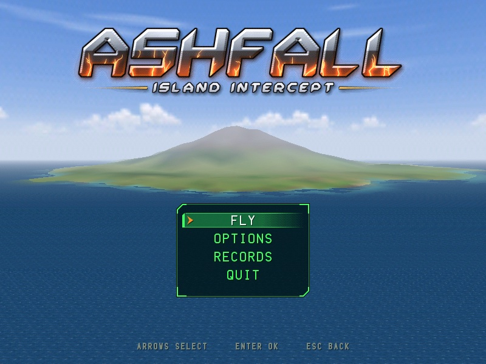
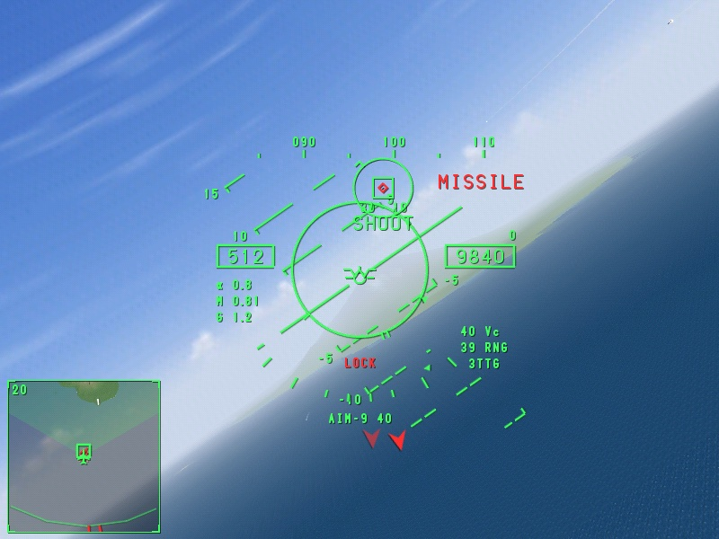
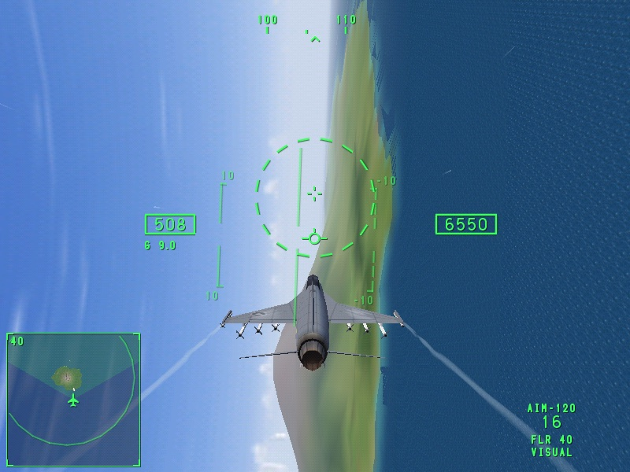
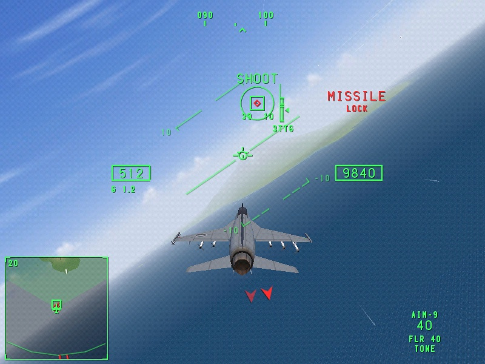
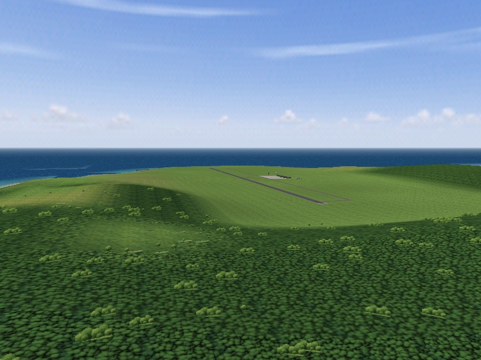
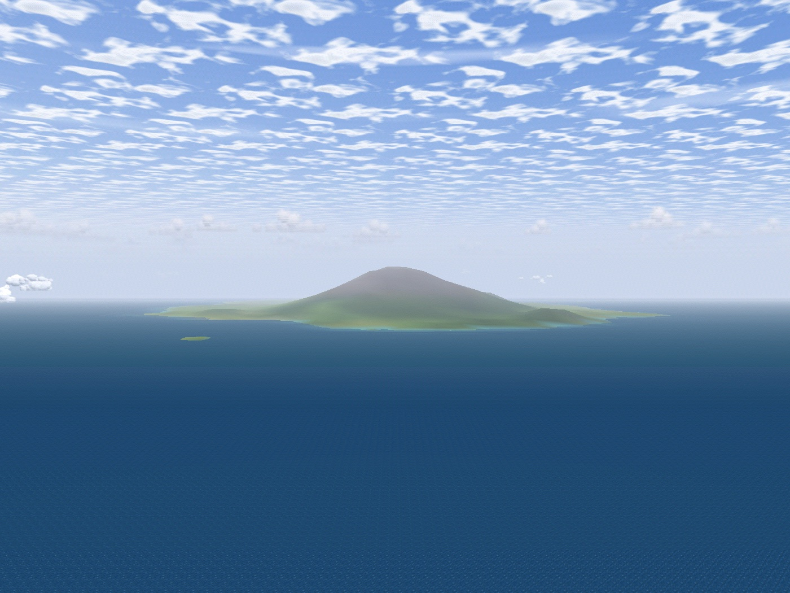
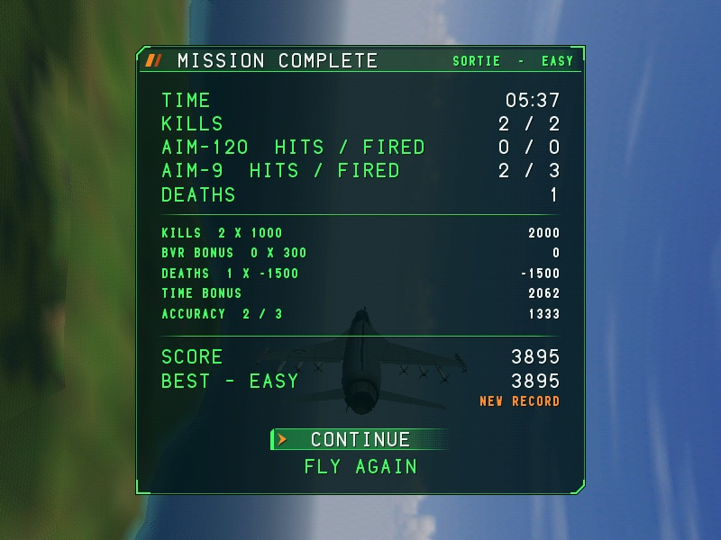

# Ashfall: Island Intercept

Arcade air combat for **Windows 98**, written in C++ for Visual C++ 6.0 and Direct3D 6 (stock DirectX 6.1).

One volcanic island, one F-16-style jet and bandits coming in from the sea. Take off from the island's airbase, find
the enemy on radar and shoot them down with radar-guided long-range and heat-seeking short-range missiles. The
F/A-18C-style HUD shows a live launch zone computed from real fly-outs of the same missile model: when SHOOT
flashes, the target cannot escape, unless it hides behind the volcano.

- Ace Combat-style controls (Expert and Novice), automatic takeoff, cockpit and chase views
- F/A-18C-style HUD: speed/altitude boxes, pitch ladder, normalized launch-zone circle (Rmax / Rne / Rmin / Raero),
  SHOOT, ACT/TTG countdowns, seeker circle, RWR warnings and tones, minimap with HAFU symbols
- Enemy AI with three difficulties, flares, terrain masking
- Training (drones) and a 3-wave Sortie with score and records
- Menus with key rebinding, video and sound options; Setup98 installer

| | |
|---|---|
|  |  |
| Cockpit view: launch-zone circle, SHOOT, ACT/TTG readouts, threat arrows | Chase view: full weapon HUD, wingtip vapour at 9 g |
|  |  |
| Locked target, MISSILE and LOCK warnings | The airbase on the island's west cape |
|  |  |
| The island from 40 km, ThinkPad T40 at 1400x1050 | Sortie results with score and records |

## Requirements

Windows 98 (SE), DirectX 6.1 or later, a 3D card (3dfx Voodoo3 class or better), 800x600 or higher. Developed on an
86Box VM (Pentium II 233, Voodoo3) and tested on an IBM ThinkPad T40 (Radeon 9000, 1400x1050).

## Download

See the GitHub releases: `ashfall-<version>-setup.exe` (installer) or `ashfall-<version>.zip` (portable).

## Building

Inside Windows 98 with Visual C++ 6.0: run `VCVARS32.BAT`, then `nmake` in the project folder. This builds
`engine\engine.lib` and `jet.exe` (shipped as `ASHFALL.EXE`). The simulation code is portable C++98; on a Mac/Linux
host `make -C tools/simh` builds a headless test harness (`tools/simh/simh test all`).

Assets are generated by deterministic Python 3 + Pillow scripts in `tools/` (`python3 tools/build_assets.py`).

Tests: `jet.exe -test all`, `jet.exe -hudtest zone|layout|contacts`, benchmarks `jet.exe -bench 60 -benchroute combat`.

## Layout

| Folder | What |
|---|---|
| `src/` | game: flight model, radar, missiles, launch-zone solver, AI, HUD, mission, menus |
| `engine/` | reusable D3D6 engine: renderer, terrain, audio, input, config |
| `data/` | island, meshes, textures, sounds, launch-zone tables |
| `tools/` | asset generators, island compiler, simh test harness |
| `docs/` | design, tasks, handoff notes, HUD layout, play-test guides |

The weapons are game mechanics with invented numbers, tuned for fun.
